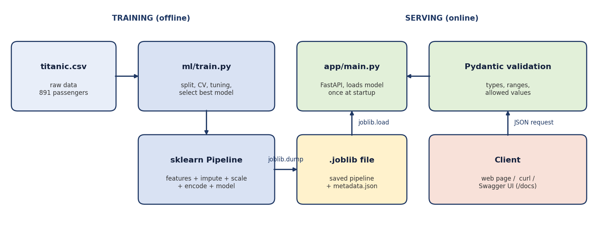

# Titanic Survival Prediction: an end-to-end ML project

A complete machine learning application: raw data → preprocessing pipeline → model training and selection → saved model (joblib) → **FastAPI** prediction API with a small web page, tests, Docker and CI.

> Educational project. It predicts survival on the historical Titanic data and is not a real-world decision tool.



**Live demo:** `<paste your Render URL here after deploying>`  ·  **API docs:** `<your-url>/docs`

## Results
| Model | Default CV ROC-AUC | Tuned CV ROC-AUC |
|---|---|---|
| Logistic Regression | 0.859 | 0.859 |
| Random Forest | 0.870 | 0.882 |
| **Gradient Boosting (selected)** | 0.890 | **0.892** |

Final test set (179 passengers, evaluated once): **accuracy 81.0%** (majority-class baseline 61.5%), precision 0.797, recall 0.681, F1 0.734, ROC-AUC 0.820.
The test ROC-AUC is lower than the cross-validation value, which is expected with a small test set. Sex is by far the most important feature (permutation importance).

## Project structure
```
titanic-ml-app/
├── app/
│   ├── main.py          # FastAPI app: /, /health, /model-info, /predict, /predict/batch
│   ├── schemas.py       # Pydantic input/output validation
│   └── static/index.html# simple web form
├── ml/
│   ├── features.py      # feature engineering shared by training and API
│   └── train.py         # train, tune, evaluate, save model + metrics + figures
├── models/              # titanic_pipeline.joblib + model_metadata.json
├── reports/             # metrics.json + figures/
├── notebooks/           # step-by-step walkthrough
├── tests/               # pytest tests (API + features)
├── docs/                # architecture diagram
├── data/titanic.csv
├── Dockerfile, render.yaml, requirements*.txt, .github/workflows/ci.yml
```

## Run it locally
```bash
python -m venv .venv
source .venv/bin/activate          # Windows: .venv\Scripts\activate
pip install -r requirements-dev.txt
python -m ml.train                 # trains and saves models/titanic_pipeline.joblib
uvicorn app.main:app --reload
```
Open http://127.0.0.1:8000 for the web page or http://127.0.0.1:8000/docs for the interactive Swagger UI.

## Use the API
```bash
curl -X POST http://127.0.0.1:8000/predict -H "Content-Type: application/json" \
  -d '{"pclass":1,"sex":"female","age":29,"sibsp":0,"parch":0,"fare":80,"embarked":"S","has_cabin":true}'
```
```json
{"survived":true,"survival_probability":0.9821,"prediction":"Survived","confidence":"high","model":"Gradient Boosting"}
```
| Endpoint | Purpose |
|---|---|
| `GET /health` | Is the server up and the model loaded? |
| `GET /model-info` | Model name, training date, test metrics |
| `POST /predict` | One passenger |
| `POST /predict/batch` | Up to 100 passengers |

Invalid input (for example `pclass: 7`) returns HTTP 422 with a clear message.

## Tests
```bash
pytest -q        # 11 tests: health, validation, sensible predictions, batch, feature engineering
```

## Deploy
**Render (free web service)**
1. Push this folder to GitHub.
2. On render.com: **New +** → **Web Service** → connect the repository.
3. Build command: `pip install -r requirements.txt && python -m ml.train --no-plots`
4. Start command: `uvicorn app.main:app --host 0.0.0.0 --port $PORT`
5. Instance type: **Free**. Optionally set `PYTHON_VERSION` to `3.12.3` and the health check path to `/health`.

The model is re-trained during the build, so the saved file always matches the installed scikit-learn version. Free instances sleep when idle, so the first request after a pause can take about 30 seconds. Check render.com for current free-plan limits.

**Docker**
```bash
docker build -t titanic-api .
docker run -p 8000:8000 titanic-api
```

## Design decisions
- **One pipeline object** (feature engineering + imputing + scaling + encoding + model), so the API cannot apply different preprocessing from training.
- **Model chosen by cross-validation**, then evaluated once on the untouched test set.
- **Input validation** with Pydantic; the model is loaded once at startup.
- `Name`/`Title` and `Ticket` are not used, so the API only asks for things a user can easily enter.

## Limitations
Small dataset (891 rows), a single train/test split, no monitoring or authentication, and the model reflects historical biases (for example by sex and class). Next steps: group-based age imputation, calibration, logging and drift monitoring, rate limiting.
